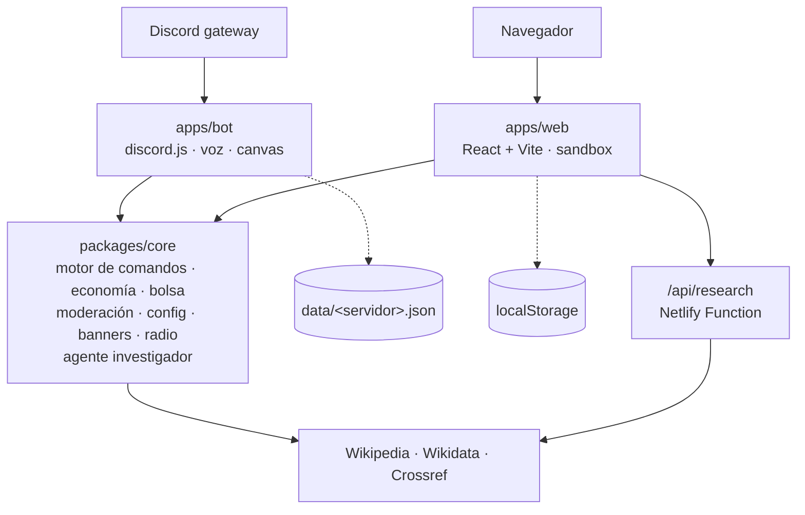

<div align="center">

# 🤖 DC Chatbot

**El bot de Discord en español que investiga con fuentes, modera en serio, monta una bolsa de valores en tu servidor, pone radio y recibe a cada miembro con su propio banner.**

[](https://github.com/AlejandroDukesini/DC-CHATBOT/actions/workflows/ci.yml)


[](LICENSE)

<br>

[](https://discord.com/oauth2/authorize?client_id=1512249712739221565&scope=bot+applications.commands&permissions=1099783334918)

<sub>🌋 <i>No puedo sobrevolar volcanes</i> · todo lo demás, sí.</sub>

<br><br>

[Funciones](#-funciones) •
[Inicio rápido](#-inicio-rápido) •
[Crear el bot](#-1-crear-la-aplicación-en-discord) •
[Permisos](#-permisos-e-intents) •
[Comandos](#-guía-de-comandos) •
[Arquitectura](#-arquitectura) •
[top.gg](#-publicar-en-topgg) •
[Problemas](#-solución-de-problemas) •
[Licencia](#-licencia)

</div>

---

## ✨ Funciones

<table>
<tr>
<td width="50%" valign="top">

### 🔎 Investigador con fuentes
Busca en **Wikipedia**, se reformula si el resultado no encaja, salta a tu idioma vía **Wikidata**, contrasta datos y añade literatura académica de **Crossref**. El resumen es *extractivo*: cada frase es textual de una fuente citada. **No inventa y no necesita claves.**

</td>
<td width="50%" valign="top">

### 🛡️ Moderación
Banear, desbanear, expulsar, silenciar, advertir con **silencio automático** al llegar al límite, purgar y registro de casos en un canal de logs. Respeta la **jerarquía de roles** igual que Discord.

</td>
</tr>
<tr>
<td valign="top">

### 💰 Economía y bolsa
Cartera y banco, recompensa diaria con **rachas**, trabajo cada hora, pagos, tienda con mejoras reales, apuestas y un **mercado de 4 acciones** que cotiza cada 10 minutos.

</td>
<td valign="top">

### 📻 Radio
Emisoras recomendadas o **cualquier enlace de streaming** en tu canal de voz. FFmpeg viene incluido.

</td>
</tr>
<tr>
<td valign="top">

### 🖼️ Bienvenidas y banners
Banner generado con Canvas (avatar, nombre y nº de miembro), mensaje personalizable, **rol automático** y anuncios con formato.

</td>
<td valign="top">

### 🤖 IA de terceros *(opcional)*
ChatGPT, Grok y Gemini con resumen y botones *Ver completa / Copiar*, y generación de imágenes con OpenAI. Solo si añades tus API keys.

</td>
</tr>
</table>

Los **37 comandos** funcionan con prefijo (`&` por defecto) **y** como slash command. Empieza por **`/help`** (o `/ayuda`, `&ayuda`).

---

## ⚡ Inicio rápido

```bash
git clone https://github.com/AlejandroDukesini/DC-CHATBOT.git
cd DC-CHATBOT
npm install                    # núcleo + demo web
npm run bot:install            # dependencias del bot
cp .env.example .env           # Windows: copy .env.example .env
# edita .env → DISCORD_TOKEN y DISCORD_CLIENT_ID
npm run deploy-commands        # registra los slash commands
npm run bot                    # ¡en marcha!
```

Requisitos: **Node.js 20 o superior** y una aplicación de Discord con bot. Nada más: FFmpeg y Canvas se instalan con npm.

---

## 🧩 1. Crear la aplicación en Discord

1. Entra en el [Discord Developer Portal](https://discord.com/developers/applications) → **New Application**.
2. **General Information** → copia el **Application ID**. Es tu `DISCORD_CLIENT_ID`.
3. **Bot** → **Reset Token** → copia el token. Es tu `DISCORD_TOKEN`. **No lo compartas nunca.**
4. En **Bot**, revisa estos interruptores:

| Ajuste | Estado | Por qué |
|---|---|---|
| **Public Bot** | ✅ Activado | Para que otros administradores puedan invitarlo (obligatorio para top.gg) |
| **Requires OAuth2 Code Grant** | ❌ **Desactivado** | Si está activado, el enlace de invitación **falla**. El bot avisa en consola al arrancar |
| **Message Content Intent** | ✅ Activado | Comandos con prefijo (`&ayuda`) |
| **Server Members Intent** | ✅ Activado | Bienvenidas, rol automático y búsqueda de miembros |
| Presence Intent | ❌ No hace falta | El bot no lo usa |

## ⚙️ 2. Configurar `.env`

| Variable | ¿Obligatoria? | Descripción |
|---|:---:|---|
| `DISCORD_TOKEN` | ✅ | Token del bot |
| `DISCORD_CLIENT_ID` | ✅ para `deploy-commands` | Application ID |
| `DISCORD_GUILD_ID` | — | Servidor de pruebas: registra los comandos al instante. Sin él se registran globalmente (hasta 1 h) |
| `OPENAI_API_KEY` · `GROK_API_KEY` · `GEMINI_API_KEY` | — | Activan `pregunta` e `imagen` |
| `OPENAI_MODEL` · `GROK_MODEL` · `GEMINI_MODEL` · `OPENAI_IMAGE_MODEL` | — | Cambian el modelo (por defecto `gpt-4o-mini`, `grok-3-mini`, `gemini-2.5-flash`, `gpt-image-1`) |
| `RESEARCH_CONTACT_EMAIL` | — | Email de contacto para Wikipedia/Crossref, según su política de uso |
| `BOT_DATA_DIR` | — | Carpeta de datos (por defecto `apps/bot/data`) |

> Deja vacías las claves que no uses. Un valor de ejemplo (como `tu_api_key`) cuenta como configurado y el proveedor fallará al usarlo.

## 🚀 3. Registrar comandos y arrancar

```bash
npm run deploy-commands   # registra los 38 slash commands (37 + /help)
npm run bot
```

Si todo va bien verás algo así:

```text
✅ Conectado como TuBot#1234 en 1 servidor(es) · 38 comandos
🤖 IA de terceros: ninguna (opcional) · 🔎 investigador: activo
🔗 Invitación: https://discord.com/api/oauth2/authorize?client_id=…&scope=bot+applications.commands&permissions=1099783334918
```

## 📨 4. Invitar el bot

Abre el enlace que muestra la consola, o construye el tuyo:

```text
https://discord.com/oauth2/authorize?client_id=<DISCORD_CLIENT_ID>&scope=bot+applications.commands&permissions=1099783334918
```

Necesitas el permiso **Gestionar servidor** en el servidor de destino. Después, en *Ajustes del servidor → Roles*, **sube el rol del bot** por encima de los roles que deba moderar o asignar.

---

## 🔐 Permisos e intents

El bot pide **solo lo que usa**, y **nunca Administrador**. Scopes: `bot` y `applications.commands`. Entero de permisos: **`1099783334918`**.

| Permiso | Comandos que lo usan |
|---|---|
| Ver canales · Enviar mensajes · Insertar enlaces · Adjuntar archivos | Todas las respuestas, embeds y banners |
| Leer el historial de mensajes | Responder a mensajes · `purgar` |
| Gestionar mensajes | `purgar` |
| Expulsar miembros | `kick` |
| Banear miembros | `ban` · `unban` |
| Aislar temporalmente a miembros | `silenciar` · silencio automático por advertencias |
| Gestionar roles | Rol automático de bienvenida |
| Conectar · Hablar | `radio` |

Los slash commands de moderación llevan `default_member_permissions`, así que Discord los oculta a quien no tenga el permiso; el núcleo vuelve a comprobarlo de todos modos.

> **¿Sale «Hacer una torta de cumpleaños» al invitar algunos bots?** Es un easter egg del propio cliente de Discord: elige una frase al azar al final de la lista de permisos y **ningún desarrollador puede configurarla**. Por eso nuestro 🌋 *«No puedo sobrevolar volcanes»* vive aquí, junto al botón de invitar y al pie de `/help`, y no en la pantalla de autorización.

---

## 🧭 Guía de comandos

> Ejemplos con el prefijo `&`. Con `/`, Discord te guía con las opciones.

<details>
<summary><b>⚙️ Primera configuración</b> (requiere <i>Gestionar servidor</i>)</summary>

```text
&config                                  → muestra todos los ajustes
&config welcomeChannel #bienvenida       → canal de los banners
&config welcomeMessage ¡Hola {user}! Bienvenid@ a {server}, eres el miembro {count}
&config autoRole @Novato                 → rol al entrar
&config logChannel #logs-moderacion      → registro de sanciones
&config bannerColor #EB459E
&config bannerTheme aurora               → aurora | noche | solido
&config warnLimit 3                      → advertencias antes del silencio (0 = off)
&config prefix !                         → nuevo prefijo (después: !ayuda)
```

Usa `ninguno` para desactivar un canal o rol: `&config autoRole ninguno`.
</details>

<details>
<summary><b>🔎 Investigar</b></summary>

```text
&investigar agujero negro
&investigar ¿qué es la fotosíntesis?
&investigar quantum computing
```

Respuesta con citas `[1]`, `[2]`, fuentes (y si se contrastaron con Wikidata), artículos con DOI, los pasos del agente y un nivel de confianza.
</details>

<details>
<summary><b>🛡️ Moderar</b></summary>

```text
&advertir @usuario spam de enlaces        → al llegar a warnLimit, silencio de 1 h
&advertencias @usuario   &perdonar @usuario
&silenciar @usuario 10m lenguaje ofensivo → 30s, 10m, 2h, 1d (máx. 28d)
&kick @usuario flood
&ban @usuario spam reiterado
&unban NombreDeUsuario                    → o su ID
&purgar 20
&casos                                    → últimas 10 acciones
```

Nadie puede sancionar a alguien con un rol igual o superior al suyo, al dueño, ni a quien esté por encima del bot.
</details>

<details>
<summary><b>💰 Economía y bolsa</b></summary>

```text
&diario            → +25 por día de racha, hasta 7
&trabajar          → una vez por hora
&balance           → cartera, banco, acciones y patrimonio
&depositar todo    &retirar 200    &pagar @usuario 150
&tienda            &comprar portatil   → +25 % en trabajar
&apostar 100 cara
&mercado           → cotizaciones con mini-gráfico de 2 horas
&invertir nexo 5   &vender nexo todo   &portafolio
&ranking
```
</details>

<details>
<summary><b>📻 Radio</b></summary>

Entra en un canal de voz y:

```text
&radios                                          → emisoras recomendadas
&radio chillhop
&radio https://stream.radioparadise.com/mp3-128  → cualquier streaming
&sonando     &detener
```
</details>

<details>
<summary><b>🖼️ Banners y anuncios</b></summary>

```text
&banner              → vista previa de tu banner
&banner @usuario
&anuncio Torneo el sábado | Inscripciones abiertas en #general. ¡Premio de 5000 🪙!
```

Los banners de bienvenida se envían solos si configuraste `welcomeChannel`.
</details>

<details>
<summary><b>🤖 IA de terceros</b> (opcional)</summary>

```text
&pregunta ¿Qué es un agujero negro?
&pregunta gemini resume la relatividad   → proveedor solo para esta pregunta
&pregunta grok                           → cambia el predeterminado (Gestionar servidor)
&imagen un gato astronauta en acuarela
&proveedores
```
</details>

---

## 🏗️ Arquitectura

**Una lógica, dos adaptadores.** Todo lo que decide *qué pasa* (argumentos, permisos, cooldowns, economía, jerarquía de moderación, el investigador y el dibujo del banner) vive en `packages/core`, sin dependencias. El bot y la demo web solo implementan la misma interfaz sobre Discord o sobre un servidor ficticio. Cada comando se define **una vez**: de ahí salen el prefijo, los slash commands, `/help` y la guía de la web.



Sin base de datos: el bot guarda un JSON por servidor (escritura atómica y cerrojo por servidor) y la demo usa `localStorage`. El mercado no guarda estado: los precios son una función determinista del tiempo.

```text
packages/core/       Lógica compartida (JS puro) + tests
  src/commands/      Definición de los 37 comandos
  src/research/      Agente investigador
  src/engine.js      Parser, permisos, cooldowns, ejecución
apps/bot/            Bot de Discord (discord.js, voz, canvas)
apps/web/            Landing + demo (React, Vite, Tailwind)
netlify/functions/   /api/research
docs/TOPGG.md        Ficha lista para top.gg
```

### Demo web vs. bot instalado

| | Demo web | Bot instalado |
|---|---|---|
| Motor de comandos | **El mismo** (`packages/core`) | **El mismo** |
| Datos | Ficticios en `localStorage`, con **Reiniciar demo** | Un JSON por servidor |
| Moderación | Sobre miembros ficticios | Acciones reales |
| Investigador | Real, vía Netlify Function | Real |
| Radio | En el navegador (solo `https://`) | En el canal de voz |
| Banners | Canvas del navegador, con iniciales | Canvas en Node, con avatar real |
| IA de terceros | No disponible | Con tus API keys |

La demo no toca Discord ni ninguna clave. Puedes actuar como *Ana (dueña)*, *Leo (moderador)* o *Sam (sin permisos)*.

---

## 🏆 Publicar en top.gg

top.gg revisa a mano cada bot: lo invita a su servidor de verificación y prueba los comandos. En [`docs/TOPGG.md`](docs/TOPGG.md) tienes la descripción corta y larga, las etiquetas, el enlace de invitación y la justificación de permisos e intents, listos para copiar.

Lista de comprobación:

- [ ] **Public Bot** activado y **Requires OAuth2 Code Grant** desactivado.
- [ ] Bot **encendido 24/7** durante la revisión (ver más abajo).
- [ ] Slash commands registrados **globalmente** (`npm run deploy-commands` sin `DISCORD_GUILD_ID`).
- [ ] `/help` responde en un servidor de pruebas.
- [ ] Nombre, avatar y descripción configurados en el Developer Portal.
- [ ] Servidor de soporte creado y enlazado en la ficha.
- [ ] Ficha enviada en [top.gg/bot/new](https://top.gg/bot/new). La aprobación la decide top.gg.

## ☁️ Mantenerlo encendido 24/7

Un bot necesita un proceso siempre activo con un WebSocket abierto, así que **no puede alojarse en Netlify**. Opciones: tu PC mientras esté encendida, una VM gratuita (p. ej. Oracle Cloud Free Tier) o un VPS pequeño. Con `pm2` se reinicia solo:

```bash
npm install -g pm2
pm2 start "npm run bot" --name dc-chatbot
pm2 save && pm2 startup
```

## 🌐 Demo web en Netlify

Sitio estático + una función serverless: cabe en el plan gratuito.

1. En Netlify: **Add new site → Import an existing project → GitHub** → `DC-CHATBOT`.
2. Elige la rama. El resto se lee de `netlify.toml` (`npm run build`, `apps/web/dist`, `netlify/functions`).
3. (Opcional) Añade `RESEARCH_CONTACT_EMAIL` en *Environment variables*.

En local: `npm run dev` → http://localhost:5173 (incluye `/api/research`).

---

## 🩺 Solución de problemas

| Síntoma | Causa | Solución |
|---|---|---|
| `Falta DISCORD_TOKEN` | No existe `.env` o está vacío | `cp .env.example .env` y rellena el token |
| `No se pudo iniciar sesión… ¿El token es correcto…?` | Token inválido o regenerado | *Bot → Reset Token* y actualiza `.env` |
| Error `Used disallowed intents` | Intents privilegiados apagados | Activa **Message Content** y **Server Members** en *Bot* |
| El enlace de invitación da error | **Requires OAuth2 Code Grant** activado | Desactívalo en *Bot* |
| No aparecen los `/comandos` | No registrados, o registro global en curso | `npm run deploy-commands`. Con `DISCORD_GUILD_ID` es instantáneo; global, hasta 1 h. Reinicia Discord con `Ctrl+R` |
| `Faltan DISCORD_TOKEN y/o DISCORD_CLIENT_ID` | Falta el Application ID | Cópialo de *General Information* |
| `Me faltan permisos en Discord…` | Rol del bot por debajo del objetivo o permiso retirado | Sube el rol del bot o vuelve a invitarlo con el enlace |
| `&comandos` no responden pero `/` sí | Message Content Intent apagado o prefijo cambiado | Actívalo, o usa `/config` para ver el prefijo |
| La radio no suena | El bot no ve tu canal de voz o el stream no es válido | Comprueba *Conectar* y *Hablar*; prueba `&radio chillhop` |
| No se envían bienvenidas | Falta `welcomeChannel` o Server Members Intent | `&config welcomeChannel #canal` y activa el intent |

---

## 🧪 Calidad

```bash
npm test           # Vitest: núcleo, función de Netlify, bot y web
npm run lint       # ESLint
npm run build      # build de producción de la demo
```

Los tests cubren el parser, permisos y jerarquía, cooldowns, todas las reglas de economía y bolsa, advertencias, configuración, bienvenidas, la validación de enlaces de radio, el investigador con fuentes simuladas, la generación de slash commands (incluido `/help`), el almacenamiento JSON, la conversión a mensajes de Discord y los flujos de la demo. GitHub Actions ejecuta lint, tests y build en cada push a `Principal` o `Beta` y en cada pull request.

## 🔒 Seguridad

- `.env`, `token.txt` y `multimedia/` están fuera del control de versiones; la plantilla es `.env.example`. El logger nunca imprime tokens ni claves.
- Los errores internos nunca llegan al chat: el usuario ve un mensaje genérico y el detalle va al log.
- Permisos comprobados en el núcleo y en Discord (`default_member_permissions`), con la jerarquía de roles de Discord.
- `allowedMentions` limitado a usuarios: ningún texto puede notificar a `@everyone`, `@here` ni a roles.
- **Radio:** solo `http(s)` sin credenciales; se bloquean IPs privadas, locales y de metadatos (también tras resolver el DNS); FFmpeg con `-protocol_whitelist http,https,tcp,tls`.
- **Investigador:** solo hosts fijos (Wikipedia, Wikidata, Crossref), consultas acotadas, timeouts y límite por IP en la función.
- **Demo:** markdown renderizado como elementos React, nunca como HTML; cabeceras de seguridad y CSP en `netlify.toml`.

**Riesgos conocidos:** el límite por IP de la función es *best effort* (uno por instancia); un servidor de radio podría redirigir tras la comprobación de DNS (mitigado por la lista de protocolos de FFmpeg); el investigador es extractivo y no responde lo que no está en las fuentes.

## 🕵️ Privacidad

El bot guarda, por servidor y en un archivo JSON local: la configuración, los saldos e inventarios de economía, las advertencias y el registro de moderación, asociados a IDs y nombres de Discord, y los motivos que escriben los moderadores. No guarda el resto de mensajes del chat. Las preguntas a `pregunta`/`imagen` se envían al proveedor de IA elegido, y las de `investigar` a Wikipedia, Wikidata y Crossref. Para borrar los datos de un servidor, elimina su archivo en `apps/bot/data/`.

---

## 🔄 Historial

**v2 (Node.js):** reescritura desde `bot.py` (discord.py, 4 comandos de IA) para compartir la lógica con la demo web. Se mantienen `pregunta`, `imagen` y `proveedores`, y se corrigieron: el proveedor de IA global que cualquiera podía cambiar, el pie del embed, `&imagen` exigiendo la clave de Gemini, respuestas guardadas sin límite, «Copiar texto» con más de 2000 caracteres y las excepciones crudas en el chat.

**Preparación para top.gg:** `/help` como alias de `/ayuda`, aviso al arrancar si el bot no es público o exige OAuth2 Code Grant, ficha en `docs/TOPGG.md` y `.env.example` completo.

## 📄 Licencia

© 2026 **Café Con Alejo** ([@AlejandroDukesini](https://github.com/AlejandroDukesini)).
Este proyecto se distribuye bajo la licencia [**Creative Commons Atribución-NoComercial-CompartirIgual 4.0 Internacional (CC BY-NC-SA 4.0)**](LICENSE).

| | |
|---|---|
| ✅ **Puedes** | Usarlo, copiarlo, redistribuirlo, modificarlo y crear versiones derivadas |
| 👤 **Atribución** | Debes dar crédito al autor original, enlazar la licencia e indicar si hiciste cambios |
| 🚫 **No comercial** | No puedes usarlo con fines comerciales ni monetarios |
| 🔁 **Compartir igual** | Toda copia o versión modificada debe distribuirse con esta misma licencia |

Crédito sugerido para tus copias o versiones modificadas:

```text
Basado en DC Chatbot de Café Con Alejo (https://github.com/AlejandroDukesini/DC-CHATBOT),
licenciado bajo CC BY-NC-SA 4.0. Modificado por <tu nombre>.
```

Las bibliotecas de terceros (discord.js, React, etc.) conservan sus propias licencias.

<div align="center"><sub>Hecho con ☕ y discord.js · 🌋 sin sobrevolar volcanes</sub></div>
